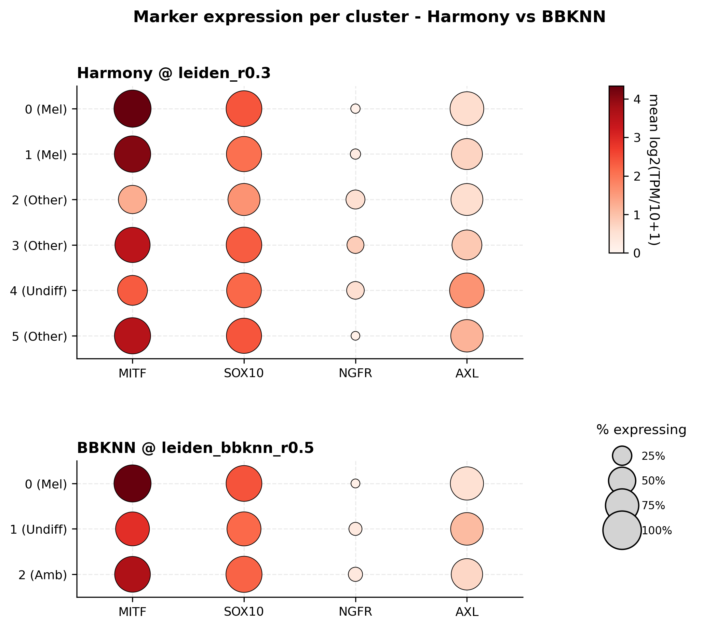

# Melanoma scRNA-seq Re-analysis

A re-analysis of the Tirosh et al. (2016) melanoma single-cell RNA-seq
dataset (GEO: [GSE72056](https://www.ncbi.nlm.nih.gov/geo/query/acc.cgi?acc=GSE72056)).
The question: can batch-integration methods recover the four melanoma
differentiation states defined by Tsoi et al. (2018), namely Melanocytic,
Transitory, Neural crest-like and Undifferentiated, in its 1,257 malignant cells?

## Findings

1. **No cluster has strong NGFR signal under either integration method.**
   Harmony and BBKNN agree: NGFR is detected in at most 25% of the cells of
   any cluster. Both intermediate states (Transitory and Neural crest-like)
   require high NGFR. The Melanocytic state is the most reproducible signal.
2. **Cells with an intermediate-state marker pattern exist, but they are
   sparse and scattered.** About 8% of malignant cells (106) show a
   Transitory or Neural crest-like pattern. They are spread across 4–5
   patients, and no patient contributes more than 37%. That is too few per
   patient to form clusters. This is consistent with Balderson et al. (2024),
   who recovered the four states as positions along a continuous trajectory.
3. **Cross-dataset test on Jerby-Arnon et al. (2018) (GSE115978).** 58% of
   that dataset (4,199 of 7,186 cells) is a re-annotation of the Tirosh cells,
   so the test has two layers. Layer 1 (the same tumors, re-processed from
   counts) reproduces finding 1. Layer 2 (860 malignant cells from new
   patients) contains an NGFR-high population. That population has lost
   SOX10 and comes mostly from one tumor, so it matches none of the four
   states.

*MITF, SOX10, NGFR and AXL per cluster, for Harmony (top) and BBKNN (bottom).
NGFR stays weak in every cluster.*

## Correction (2026-11)

The Layer 2 NGFR-high clusters were first labeled Neural crest-like and
Transitory, and read as evidence that the Tirosh cohort lacks a
dedifferentiated tumor. A recheck against the full four-marker table showed
that both clusters have lost SOX10 (detection 2.8% and 10.7%, against 77–85%
in the same cohort's Melanocytic clusters). Tsoi et al. define both states
as SOX10-high. Those labels and that explanation are withdrawn. The recheck
also found that the "Undifferentiated" labels in notebooks 04 and 05 do not
meet the full definition.

Rules and results: [`docs/annotation_recheck.md`](docs/annotation_recheck.md).
The notebooks keep their original labels, with a note at the top of each
affected notebook.

## Methods

- **Data.** GSE72056 is supplied as log2(TPM/10+1) and is used as supplied,
  with no re-normalization.
- **Pipeline.** Highly variable genes (`flavor="seurat"`), then PCA,
  integration, Leiden clustering, and manual annotation with MITF, SOX10,
  NGFR and AXL.
- **Integration methods compared.** Harmony (correction of the PCA
  embedding) and BBKNN (batch-balanced kNN graph), with patient as the batch.
- **Methods considered but not used.**
  - scVI / scANVI and UCE need raw counts, which are controlled-access for
    this dataset. UCE also needs an A100-class GPU.
  - Seurat RPCA failed at the R–Python bridge. Scanorama, from the same
    method family, failed on the small patient batches.
  - scGen is incompatible with current scvi-tools and no longer maintained.

## Repository

| Path | Contents |
|---|---|
| `notebooks/00`–`04` | Data check, QC, PCA, Harmony, clustering and annotation |
| `notebooks/05` | BBKNN |
| `notebooks/07` | Harmony vs. BBKNN comparison (there is no notebook 06) |
| `notebooks/08` | Jerby-Arnon Layer 2 (new patients) |
| `notebooks/09` | Jerby-Arnon Layer 1 (Tirosh tumors) |
| `scripts/recheck_tsoi_annotation.py` | The 2026-11 annotation recheck |
| `docs/annotation_recheck.md` | Recheck rules and results |

## Reproducing

1. Create the environment:
   `conda env create -f environment.lock.yml && conda activate melanoma-scrnaseq`
2. Download from GEO:
   - `GSE72056_melanoma_single_cell_revised_v2.txt.gz` into `data/raw/`
   - `GSE115978_counts.csv.gz` and `GSE115978_cell.annotations.csv.gz` into
     `data/raw/jerby_arnon/` (checksums in `data/jerby_arnon_CHECKSUMS.md5`)
3. Run the notebooks in order, then `python scripts/recheck_tsoi_annotation.py`.

## About this release

This repository is a cleaned-up release of the project's working repository.
The analysis was run between May and November 2026 and is published here as
a single commit, without the development history. The notebooks are the
original analysis notebooks with their saved outputs. They were not re-run
for this release; only local file paths and some comments and wording were
edited.

## AI use

I was responsible for the research question, methodological decisions and
checking the results. The code was written by an AI coding tool (Claude Code).

## References

- Tirosh I, et al. *Science* 352:189–196 (2016). doi:10.1126/science.aad0501
- Tsoi J, et al. *Cancer Cell* 33:890–904 (2018). doi:10.1016/j.ccell.2018.03.017
- Jerby-Arnon L, et al. *Cell* 175:984–997 (2018). doi:10.1016/j.cell.2018.09.006
- Balderson B, et al. *Briefings in Functional Genomics* 24:elad055 (2025; online 2024). doi:10.1093/bfgp/elad055
- Korsunsky I, et al. Harmony. *Nature Methods* 16:1289–1296 (2019)
- Polański K, et al. BBKNN. *Bioinformatics* 36:964–965 (2020)

## License

[MIT](LICENSE)
