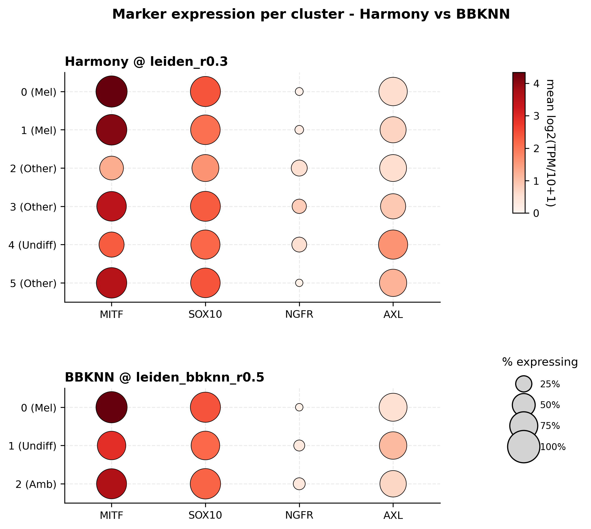
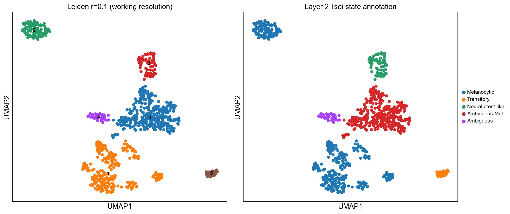
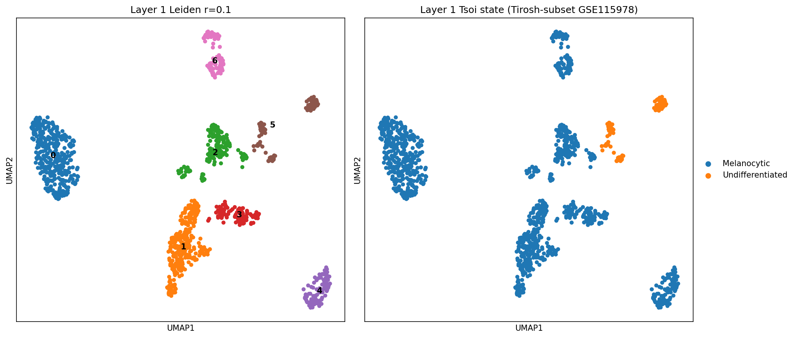

# Learning to Re-analyze: A Methodological Study of Single-Cell Integration Methods on the Tirosh et al. (2016) Melanoma Dataset

A reproducibility-focused re-analysis of the Tirosh et al. (2016) melanoma
single-cell RNA-seq dataset (GSE72056), evaluating how well classical
batch-integration methods (Harmony, BBKNN) recover the four Tsoi et al.
(2018) melanoma dedifferentiation states (Melanocytic, Transitory, Neural
crest-like, Undifferentiated). Deep-learning methods (scVI/scANVI, UCE) were
evaluated at the feasibility stage and ruled out, as their required raw
counts are controlled-access. The project is organized as a staged
investigation around a single falsifiable claim (**P1**) and its
cross-dataset test.

> **Revision (2026-11-05).** An annotation recheck
> ([decision log entry j](docs/decision_log.md),
> [`docs/stage4_annotation_recheck.md`](docs/stage4_annotation_recheck.md))
> withdrew the Stage 4 finding that the independent cohort "recovers"
> the intermediate states. Those cells lack SOX10, which the Tsoi
> definitions of both intermediate states require. The findings below
> reflect the recheck. The original stage reports are kept with revision
> notices.

---

## The Research Arc

This project follows one question across four stages: **can integration
methods recover the NGFR-dependent intermediate Tsoi states (Transitory,
Neural crest-like) in melanoma malignant cells?**

- **Stage 1 — Literature grounding.** Reading notes on Tirosh 2016, Tsoi
  2018 (the four-state framework), and integration-method reviews.
- **Stage 2 — Classical pipeline.** QC → HVG → PCA → Harmony → Leiden →
  Tsoi annotation on 1,257 Tirosh malignant cells. A robust Melanocytic
  pole; no cluster with strong NGFR signal. The original label set was
  "Melanocytic and Undifferentiated, two of four states". It is qualified
  by the 2026-11 recheck: the Undifferentiated label does not meet the
  full four-marker definition.
- **Stage 3 — Cross-method comparison.** Six integration methods
  evaluated; four ruled out with documented reasons. Harmony and BBKNN
  were compared head-to-head. Both give the same overall picture: NGFR
  signal is weak in every cluster. Because two structurally different
  methods agree, this is treated as a property of the data rather than of
  one method (**P1**).
- **Stage 4 — Cross-dataset test.** P1 is tested against Jerby-Arnon 2018
  (GSE115978). A cohort-composition discovery (58% of that dataset is a
  re-annotation of Tirosh) restructures the test into layers. On the
  independent cohort, an NGFR-high population appears. It was first
  annotated as Neural crest-like and Transitory and read as evidence that
  Tirosh "lacks a dedifferentiated tumor".
- **Recheck (2026-11).** Checked against the project's own Tsoi table,
  that NGFR-high population has lost SOX10, so it is not an intermediate
  state, and 96% of it comes from one tumor. Tirosh, meanwhile, does
  contain cells with the intermediate-state marker pattern (~8%), but they
  are scattered across patients. The Stage 4 mechanism is withdrawn.

*Stage 3: across both Harmony and BBKNN clusters, NGFR stays weak (NGFR
is detected in at most 25% of the cells of any cluster), so no cluster
shows the strong NGFR signal the intermediate states require.*

---

## Key Findings

1. **No strong NGFR-defined cluster in Tirosh 2016, under either method
   (P1).** Harmony and BBKNN agree that NGFR stays weak: no cluster has
   NGFR detected in more than 25% of its cells. The Melanocytic pole is
   the most reproducible signal. Whether the modestly NGFR-elevated
   clusters (14–25% detection) count as Transitory or Neural crest-like
   depends on an NGFR threshold the original analysis never fixed (see
   the recheck).

2. **The independent cohort's "intermediate states" were a
   misannotation.** Its NGFR-high clusters (72 + 28 cells) have lost SOX10:
   detection is 2.8% and 10.7%, against 77–85% in its Melanocytic
   clusters. Tsoi's definitions of both Neural crest-like and Transitory
   require SOX10↑. Only 6 of its 860 malignant cells (0.7%) show an
   intermediate-state marker pattern. Instead, 80 cells are NGFR+ SOX10−,
   96% of them from one tumor (Mel110), and this population matches none
   of the four states.

| Layer 2 (independent New cohort) | Layer 1 (same Tirosh tumors) |
|---|---|
|  |  |
| Original labels, now withdrawn: "NC (72) + Transitory (28)" | Original labels: Melanocytic + Undifferentiated |

3. **Intermediate-pattern cells exist in Tirosh 2016, but sparsely and
   scattered.** About 8% of malignant cells (71 with a Transitory pattern,
   35 with an NC pattern) are spread across 4–5 patients, and no patient
   contributes more than 37%. That is too few per patient to form discrete
   clusters. It is consistent with Balderson et al. (2024), who recovered
   all four states as positions along a continuous trajectory. The earlier
   explanation, that Tirosh "lacks a dedifferentiated tumor", is withdrawn.
   (Cell-level counts are detection-based and affected by dropout; see
   the recheck's limitations.)

Full analysis in the stage reports below; the recheck supersedes the
Stage 4 interpretation.

---

## Repository Guide

**Reports (start here):**
- [`docs/stage2_report.md`](docs/stage2_report.md) — classical pipeline (labels qualified by the 2026-11 recheck)
- [`docs/stage3_report.md`](docs/stage3_report.md) — cross-method comparison, P1
- [`docs/stage4_report.md`](docs/stage4_report.md) — cross-dataset test (interpretation superseded; see revision notice)
- [`docs/stage4_annotation_recheck.md`](docs/stage4_annotation_recheck.md) — 2026-11 recheck of every stage's Tsoi labels against the project's own marker table

**Decision trail:**
- [`docs/decision_log.md`](docs/decision_log.md) — 10 entries (a–j): method exclusions, methodological pivots, framing corrections, a documented statistical self-correction (entry i), and the withdrawal of the Stage 4 intermediate-state labels (entry j)
- [`docs/stage3_feasibility_audit.md`](docs/stage3_feasibility_audit.md), [`docs/stage4_feasibility_audit.md`](docs/stage4_feasibility_audit.md) — method-feasibility evaluations
- [`docs/stage4_dataset_schema.md`](docs/stage4_dataset_schema.md) — GSE115978 schema and the cohort-composition discovery

**Notebooks** (`notebooks/`): `00`–`09`, in analysis order. Note: two `05`
notebooks (`05_bbknn`, the adopted method; `05_seurat_rpca`, a ruled-out
alternative kept for traceability) and no `06` — numbering reflects the
project's actual decision history rather than a clean rewrite.

**Literature notes:** `docs/literature/` — Tirosh 2016, Tsoi 2018,
Balderson 2024 (a classical re-analysis benchmark), and Heumos 2023
(a single-cell best-practices review).

---

## Methodology Highlights

- **Systematic method evaluation.** Six integration methods evaluated;
  four ruled out (scVI/scANVI, UCE, Seurat RPCA/Scanorama, scGen), each
  with a decision-log entry. A trajectory method (scVelo) was separately
  ruled out for Stage 4.
- **Verification discipline.** Numerical claims were checked against
  notebook outputs before being written into reports; smoke-test scripts
  (`scripts/smoke_test/`) and dataset checksums
  (`data/jerby_arnon_CHECKSUMS.md5`) document what was tried and verified.
- **Transparent self-correction.** Decision-log entry (i) records a
  statistical over-reading (a patient/treatment confound) that was caught
  by sanity checks and corrected before any conclusion was finalized.
  Entry (j) records a correction made after a conclusion *had* been
  finalized. Stage 4's intermediate-state labels were rechecked against
  the project's own marker table and withdrawn. The original reports stay
  in place with revision notices, so the error remains auditable.

---

## Reproducibility & Data Access

- **Environment:** pinned core versions in
  [`environment.lock.yml`](environment.lock.yml) (the authoritative
  reproducibility record); a looser human-readable
  [`environment.yml`](environment.yml) is also provided. Versions were
  confirmed for Stages 1–3 via notebook runtime prints and a conda export;
  the Stage 4 notebooks did not print versions, so their environment is
  inferred from the same conda snapshot rather than byte-level confirmed.
- **Data:** raw data are not committed (gitignored). GSE72056 (Tirosh
  2016, public log-TPM) and GSE115978 (Jerby-Arnon 2018, public counts)
  are available from GEO. Raw counts / FASTQ for count-based deep-learning
  methods are controlled-access (DUOS/dbGaP), which is why those methods
  were ruled out — see the decision log.
- **Analysis logic** currently lives in the notebooks; `src/` is reserved
  for future module extraction.

---

## Status & Future Work

Stages 1 through 4 (cross-dataset C1, Layers 1–2) are complete. The
2026-11 recheck (entry j) withdrew the Stage 4 interpretation.

The open item is to re-annotate Stages 2–4 under **one written rule set**:
marker thresholds and the single-patient rule fixed before annotating,
using both detection and expression level. Further future work:
- Layer 3: joint cross-cohort integration of all 7,186 cells;
- C2-PAGA: continuous trajectory analysis, which suits the sparse,
  scattered intermediate-pattern cells better than discrete clustering.

---

## License

[MIT](LICENSE)

---

## AI Collaboration & Intellectual Ownership

This project was developed with an AI-assisted workflow, using the Claude
Code CLI to help implement and document my analyses. To keep the division
of labor transparent and academically honest, the collaboration model is
defined explicitly in CLAUDE.md: *the student designs the analysis; Claude
Code implements.*

**My Role — Analysis Design & Scientific Decisions:**
All core scientific questions, biological assessments, and methodological
decisions were made independently by me. These include, but are not limited
to:

- **Data preprocessing assessment.** Independently identifying that the
  baseline Tirosh 2016 dataset was already supplied as **log2(TPM/10+1)** —
  i.e., TPM-normalized and log-transformed — and therefore deciding to
  bypass the standard normalization step to avoid double normalization and
  double log-transformation.

- **Methodological pivots & restructuring.** Decisively adjusting the
  research architecture after confirming that the **raw counts were locked
  behind DUOS controlled-access restrictions**. This led to the proactive
  exclusion of deep generative models (e.g., scVI/scANVI) and foundation
  models (e.g., **UCE**) in favor of evaluating classical integration
  methods (Harmony, BBKNN).

- **Engineering dependency evaluation.** Identifying a severe
  API-compatibility break in the **scGen** library (it emits the deprecated
  scvi-tools 0.x interface, unusable with current scvi-tools) and decisively
  ruling it out as a candidate before integration (decision-log entry f,
  2026-05-22).

**AI's Role — Implementation & Drafting Support:**
Claude Code served as an implementation and drafting assistant. It
translated my analytical specifications into concrete Scanpy code, produced
figures and documentation scaffolding, ran verification and sanity checks,
and generated commit records with Co-authored-by signatures via local Git
delegation. On occasion it also surfaced candidate interpretations of
intermediate results, which I treated as proposals to be tested rather than
conclusions. The clearest case is **decision-log entry (i)**: during Stage 4,
the AI assistant proposed a statistically striking interpretation — that the
NGFR-high states were treatment-induced, backed by a χ² test at p < 0.0001.
It did not sit right with me, so rather than adopt it I directed a set of
patient-level sanity checks on the experimental design. Those checks showed
the signal was driven almost entirely by a single tumor (Mel110, ~74%), that
treatment status was fully confounded with patient identity, and that the
narrative's core premise was empirically false. I rejected the interpretation
and refined P1 to a cohort-composition form (later withdrawn by entry j). The AI could generate
a plausible hypothesis; recognizing that it was unsafe and choosing to test it
rather than adopt it was my call. Directing a capable AI — specifying the
analyses, auditing its output, and overriding it when the data demanded — was
itself a core skill this project developed.

The audit also ran the other way. In a later review (2026-11), the AI
assistant flagged that the Stage 4 intermediate-state labels contradicted
the project's own Tsoi marker table: those clusters had lost SOX10. I
directed a read-only recheck of every stage's annotation and decided to
withdraw the Stage 4 labels and mechanism (decision-log entry j). The
error itself traces back to my annotation process: no thresholds or
single-patient rule were written down before annotating.
